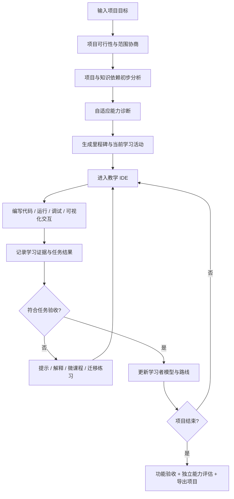
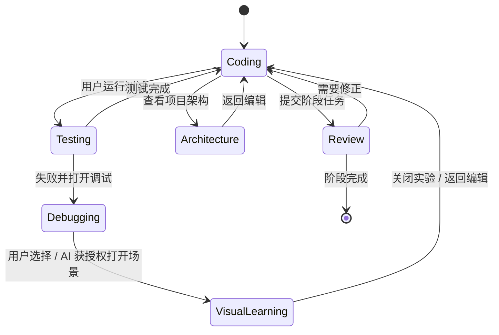
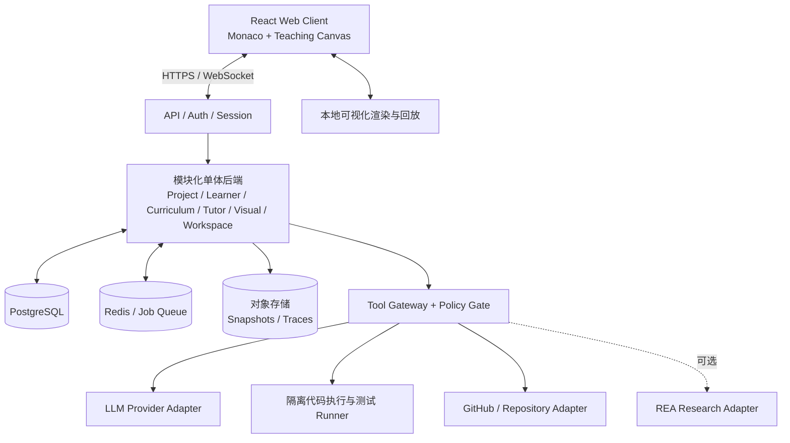
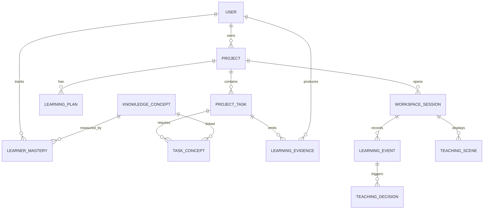

# AI 自适应项目式编程教学平台

**产品与技术总体设计文档 | V1.0（方案基线）**  
**工作代号：ProjectWeave（暂定，非正式产品名称）**  
编制日期：2026 年 10 月 10 日  
状态：供产品讨论、技术评审和 MVP 立项使用  

> **一句话定位**：用户选择一个真正想完成的软件项目，系统诊断其现有能力，生成可验证的个性化学习路线，并在专门的教学 IDE 中借助 AI、真实运行反馈和交互式可视化帮助用户逐步独立完成项目。

**文档声明**：本文是产品设计与拟议技术方案，不代表系统已实现。所有时延、成本、迭代周期和掌握度指标均为设计目标或待验证假设。文中“REA”指开源项目 [morluto/rea](https://github.com/morluto/rea)，不是恢复闭源软件源代码的保证。

## 0. 执行摘要

### 0.1 产品愿景

目前编程学习与软件开发往往是两条断开的路径：教程难以匹配学习者真正想做的项目，AI 编程助手又容易替用户完成工作，却难以证明用户掌握了知识。本产品以“**真实项目目标 + 持续学习者建模 + 自适应教学决策 + 交互式可视化编程工作台**”形成闭环。

产品并非“聊天机器人加编辑器”，而是一个学习操作系统：课程随项目和学习表现变化；AI 通过教学政策决定何时提问、给出多少提示和何时切换可视化；用户在项目中产出的代码、解释、调试与迁移能力成为可追溯的学习证据。

### 0.2 六个核心系统

| 系统 | 主要职责 | 典型输出 |
|---|---|---|
| Project Engine | 理解用户目标、接入开源项目或合法软件分析结果、生成项目任务图 | ProjectSpec、任务依赖图、来源证据 |
| Learner Engine | 管理知识图谱、能力估计、学习证据及不确定性 | LearnerProfile、ConceptMastery |
| Curriculum Engine | 将任务与知识先修关系联合规划成动态学习路径 | LearningPlan、NextActivity |
| Tutor Engine | 根据实时上下文决定教学策略、提示深度与评价方式 | TeachingDecision、TutorMessage |
| Visual Interaction Engine | 解析教学场景规格、绑定可靠数据并渲染交互式实验 | TeachingScene、VisualizationEvent |
| Workspace Orchestrator | 管理 IDE 布局、焦点、高亮、调试面板及操作权限 | WorkspaceAction、LayoutState |

**关键架构原则**：AI 决定教学意图；确定性程序负责测试、数据采集、权限校验和可视化执行。第一版采用模块化单体，不急于拆微服务或训练专用大模型。

### 0.3 成功定义

用户不仅完成一个能运行的项目，还能说明关键设计、独立修复新问题，并把知识迁移到相关新任务。系统的主要成功指标是**独立能力增长**，而不是 AI 代写的代码量。

## 1. 产品定位、目标与边界

### 1.1 目标用户

| 用户层级 | 典型诉求 | 适配策略 |
|---|---|---|
| 零基础 | “我想做一个自己的网页应用，但不知道如何开始” | 更细的任务粒度、术语解释、基础执行可视化、频繁的低压力诊断 |
| 初中级 | “会 Python，想通过真实项目学习前端或 C++” | 迁移已有能力、跳过已掌握内容、侧重调试与设计 |
| 中高级 | “想理解复杂项目、参与开源或重建某个功能” | 架构图、源码定位、性能与并发诊断、任务自主选择 |
| 资深开发者 | “想快速掌握陌生代码库并验证新技术” | 低干预、架构与依赖分析、高难度独立任务 |

各层共享同一个产品闭环，但教学深度、帮助方式、任务粒度与可视化内容不同。对儿童或学校场景的合规性另行评估，MVP 默认面向可独立注册的成人用户。

### 1.2 产品目标

- G1：用户通过自然语言定义有价值且范围可控的项目目标。
- G2：系统以少量、高区分度的诊断活动估计项目相关知识，而非只测语法分数。
- G3：生成具有依赖关系、明确交付物和验收测试的个性化路线。
- G4：IDE 中的 AI 能结合代码、错误、测试、调试器与历史学习证据提供指导。
- G5：可视化是第一等交互通道，支持“代码 ↔ 执行状态 ↔ 图形操作 ↔ 学习评价”的闭环。
- G6：形成可运行、可导出、可持续维护的项目及可信的学习成长档案。

### 1.3 非目标（初期明确不做）

- 不承诺用户输入任意目标后都能自动生成高质量、可运行的全课程。
- 不在 MVP 同时支持所有语言、操作系统、原生 GUI 和 GPU 工作流。
- 不以直接复制商业软件、绕过保护或发布逆向恢复代码为产品能力。
- 不用模型自报的“掌握率”代替实际学习证据，也不保证学习成果可直接换算为学分或证书。
- 不默认记录每次按键、读取无关个人文件或让 Agent 自动执行高风险操作。

## 2. 端到端用户旅程

### 2.1 标准流程



### 2.2 样板项目：Markdown 笔记编辑器

**用户输入**：“我会一点 Python，想做类似 Obsidian 的 Markdown 编辑器。” 系统澄清目标平台、期望功能和每周学习时间，避免直接把复杂商业软件全量克隆作为目标。

**推荐初始范围**：Web 端笔记编辑、Markdown 实时预览、本地保存、简单全文搜索；插件系统、桌面打包和多端同步放入进阶路线。最终生成独立原创实现，参考项目仅在许可证许可的范围内复用。

**示例项目里程碑**：M1 项目启动及页面骨架；M2 文本输入与状态管理；M3 Markdown 解析与预览；M4 数据持久化；M5 搜索与异常处理；M6 测试、构建与独立扩展任务。

### 2.3 三种不可混淆的完成状态

1. **任务实现通过**：自动测试、功能验收或人工检查通过。
2. **知识掌握证据充分**：理解、应用、调试与独立性获得足够有效证据。
3. **项目最终交付通过**：构建产物、核心功能、必要文档、安全检查与独立扩展任务满足要求。

“AI 提示后代码正确”可满足第 1 点，但不自动满足第 2 点。

## 3. 信息架构与页面设计

### 3.1 一级页面

| 页面 | 主要内容 | 关键交互 |
|---|---|---|
| 项目发现/创建 | 自然语言目标、项目模板、GitHub 链接、技术栈与范围 | 创建目标、查看可行性、选择路线 |
| 能力诊断 | 预测题、解释题、小编码任务、动态难度 | 跳过已知、回答与运行验证 |
| 学习路线 | 项目任务图、知识依赖、里程碑、可调整范围 | 展开任务、查看先修知识、确认阶段 |
| 教学 IDE | 文件树、编辑器、预览、终端、测试、AI Mentor、教学画布 | 编程、调试、教学互动、布局切换 |
| 项目历史 | 里程碑、代码快照、测试记录、项目交付 | 回放、导出、恢复、分享 |
| 成长档案 | 技能图、学习证据、独立任务完成情况 | 查看证据来源和改进建议 |
| 设置与权限 | AI 介入等级、模型预算、自动操作授权、隐私设置 | 锁定布局、授权与撤销 |

### 3.2 教学 IDE 桌面布局

```text
┌──────────────────────────────────────────────────────────────────────┐
│ 项目 / 当前任务 / 进度        [编程] [调试] [实验] [架构]  用户设置    │
├────────────┬──────────────────────────┬──────────────────────────────┤
│ 文件与任务 │ 代码编辑器 Monaco        │ AI Mentor                    │
│ 树         │ 行内诊断 / 教学批注       │ 当前学习目标 / 证据 / 提示   │
│            ├──────────────────────────┤                              │
│            │ 预览或 Teaching Canvas   │ 快捷操作 / 对话 / 问答       │
├────────────┴──────────────────────────┴──────────────────────────────┤
│ 终端 / 测试 / 调试 / 学习事件摘要                                       │
└──────────────────────────────────────────────────────────────────────┘
```

编辑器与画布的相对比例根据工作模式切换；用户手动布局与“锁定布局”优先于 AI 建议。移动端先支持课程浏览、问答与学习报告，不承诺完整桌面级 IDE。

### 3.3 工作台状态机



视图布局状态不等同于学习任务状态；切换模式不应重启或丢失代码执行上下文。

## 4. 需求规格与用户故事

### 4.1 核心功能需求（MUST / SHOULD / LATER）

| 编号 | 功能 | 优先级 | 核心验收标准 |
|---|---|---|---|
| FR-01 | 自然语言项目定义 | MUST | 能生成可编辑的 ProjectSpec，明确范围与不可行项 |
| FR-02 | 初始能力诊断 | MUST | 至少覆盖目标项目的关键先修知识，记录证据与不确定性 |
| FR-03 | 项目任务 DAG | MUST | 每个任务有前置依赖、可验证交付物及完成条件 |
| FR-04 | 动态学习路线 | MUST | 新的学习证据能触发当前活动调整且保留变更记录 |
| FR-05 | 教学 IDE | MUST | 编辑、保存、运行、查看测试、预览，异常恢复不丢代码 |
| FR-06 | AI 渐进式提示 | MUST | 默认从问题/局部提示开始，答案级帮助需明确操作 |
| FR-07 | 标准可视化场景 | MUST | 数组、变量状态、调用栈、执行时间线至少实现两类端到端 |
| FR-08 | AI 控制工作台 | SHOULD | 支持高亮、打开画布、布局建议、撤销与布局锁定 |
| FR-09 | 学习证据与档案 | MUST | 能展示掌握判断所依据的活动、结果与帮助程度 |
| FR-10 | GitHub 项目导入 | SHOULD | 检查许可、语言、构建与测试；支持不适配时解释原因 |
| FR-11 | REA 项目研究 | LATER | 保留证据及来源，不把逆向结果冒充源码或版权许可 |
| FR-12 | 自定义教学小程序 | LATER | 模板不足时在安全沙箱内生成并验证新场景 |
| FR-13 | 项目导出 | MUST | 用户可导出自己的仓库、任务结果与学习概要 |

### 4.2 典型用户故事

- US-01：作为零基础用户，我希望系统用少量示例帮我判断应该从哪里学起，而不是先完成一整门语言课。
- US-02：作为有经验用户，我希望跳过已经掌握的内容，但在真正遇到知识缺口时得到补充。
- US-03：作为正在调试的用户，我希望一键从错误定位跳转到执行时间线，并看到可验证的状态变化。
- US-04：作为重视自主思考的用户，我希望控制 AI 主动介入频率与提示深度。
- US-05：作为希望参与开源的用户，我希望最终形成可提交的修改，而不是被迫从零复刻所有功能。
- US-06：作为用户，我希望知道系统为什么推荐当前知识点，并能修改学习路线。

## 5. 领域模型一：真实项目 Project Engine

### 5.1 项目来源与模式

**Track A：从零重建（Rebuild Track）**。从开源项目、软件功能说明或合法行为研究中提取目标行为，设计范围可控的原创实现。适合初中级。

**Track B：开源贡献（Contribution Track）**。克隆可使用的开源仓库，分析模块和测试，从修复 bug 或实现小功能入手。适合中高级。

两种模式都使用统一的 ProjectSpec，但验收方式不同：前者验收功能等价的目标范围；后者验收对目标仓库的有效变更、相关测试与代码规范。

### 5.2 ProjectSpec 必要字段

`id`、`title`、`mode`、`description`、`targetFeatures[]`、`nonGoals[]`、`stack[]`、`complexity`、`sourceRefs[]`、`licenseReview`、`milestones[]`、`acceptanceCriteria[]`、`environmentSpec`、`version`。

**来源追溯**：每个源项目记录 URL、仓库提交 SHA / 软件版本、许可证、来源证据、限制与被采用的功能；课程生成不能隐式假设来源稳定。

### 5.3 任务图规范

每个 `ProjectTask` 包含 `taskId`、`dependsOn[]`、`deliverables[]`、`requiredConceptIds[]`、`starterState`、`tests[]`、`reviewRubric`、`estimatedEffortBand`、`status`。任务图必须允许分支、回退和可选任务，但不得产生不可解释的循环先修。

**可行性闸门**：进入课程生成前检验项目是否可合法使用、能在选定环境中构建、是否存在足够明确的可测试功能，以及是否需缩减项目范围。失败时向用户解释替代方案。

### 5.4 REA 接入边界

REA 可以帮助研究 JavaScript/Electron、网站、部分原生程序和其它支持的目标，输出模块关系、调用信息、伪代码、行为观察及相应证据。产品将其作为 **Project Research Adapter**，而不是“任何软件一键还原器”。

接入规则：用户确认拥有分析权利或合法依据；限定目标和用途；分离事实、推断、未知项；不默认上传专有二进制；不生成规避 DRM、许可限制或其他保护的步骤；对需要清洁室实现或专业法律评估的场景予以标记。每份分析结果设 `confidence` 与 `provenance`，由 Project Engine 审核后转换成可教学功能规格。

## 6. 领域模型二：学习者 Learner Engine

### 6.1 知识图谱

`KnowledgeConcept` 表示一个可测量的最小能力单元，字段：`conceptId`、`title`、`domain`、`prerequisiteIds[]`、`objectives[]`、`assessmentMethods[]`、`examples[]`、`version`。例如“闭包的变量捕获”“React 状态更新”“文件系统异常处理”。不要把“会 React”当作不可分解的单一知识点。

### 6.2 四维能力与不确定性

对每个知识点记录：

- **理解（Understanding）**：解释原理、预测执行结果、识别反例。
- **应用（Application）**：在实际项目中正确选用并实现。
- **调试（Debugging）**：定位故障、验证假设、解释原因。
- **独立性（Independence）**：在不同帮助级别下解决任务的程度。

每个维度可以保存 `estimate`、`confidence`、`lastObservedAt`、`evidenceCount`、`modelVersion`。估计值是系统推断，不能直接写作客观测量分数；没有足够证据时显示“尚不确定”。

### 6.3 学习证据

`LearningEvidence` 至少包含 `userId`、`conceptId`、`taskId`、`activityId`、`evidenceType`、`observedOutcome`、`hintLevel`、`codeVersion`、`rubricVersion`、`timestamp`、`sourceEventIds[]`。证据类型包括预测题、解释题、独立编码、单元测试、调试过程、迁移任务、延迟复测。

避免把“输入速度”“停顿时长”当作能力的直接证据。时间和重复测试可以作为选择是否提供帮助的弱信号，但不应单独决定掌握度。

### 6.4 初始诊断策略

诊断范围由项目需求图反推，而不是一场通用语言考试。先通过自述和可选跳过功能确定粗略先验，再选择少量难度递进的可执行任务与理解问题；根据结果继续追问或停止。MVP 使用清晰的规则与保守的概率更新，后续有足够数据时再比较 BKT/IRT 等方法。

### 6.5 能力更新与防误判

每次测评经过 `EvidenceValidator → MasteryUpdater → ConfidenceCalculator`；为模型记录版本。AI 口头评价只作为辅助，不替代测试和人工可核查的 rubric。对“多次求助后完成”“AI 直接提供完整代码”降低独立性证据权重，并安排新的无提示迁移练习。

## 7. 领域模型三：课程 Curriculum Engine

### 7.1 双图规划

- **项目任务图**：用户最终需要做出什么。
- **知识依赖图**：完成任务需要理解什么。

通过 `TaskConceptRequirement` 建立多对多关联。课程不是静态章节清单，而是在约束条件下生成的一条有版本的学习路径。

### 7.2 课程规划策略

输入：当前项目任务、先修关系、能力估计及置信度、学习时间预算、用户偏好、项目截止要求。输出：当前阶段的 `LearningActivity` 序列和候选分支。优化方向是降低不必要的知识补课，同时避免知识缺口造成长期阻塞。

一个可解释的优先级规则示例：

`priority = dependency_urgency × knowledge_gap × confidence_adjustment × project_relevance / effort_band`

此公式是启发式设计，不是已经验证的学习科学定律，实际权重需通过试验调整。

### 7.3 动态重规划的约束

- 已经通过验收的项目里程碑不随意撤销，除非测试或需求版本发生变化。
- 路线变更应显示原因与影响，例如“插入 15 分钟闭包实验，因为两次事件回调任务均未通过预测题”。
- 支持“坚持当前路线”“稍后补课”“切换难度”选项；高风险跳过要求确认。
- 每次重规划保存 `planVersion`、`triggerEvidenceIds`、`diff` 和 `reason`。

## 8. Tutor Engine：教学策略与 AI 交互

### 8.1 核心职责

Tutor Engine 不只是回答用户消息，还应订阅关键学习事件，结合当前目标和能力状态生成 `TeachingDecision`。它可使用提问、提示、反例、解释、可视化、测试建议或路线调整，不直接把“交付最快”作为唯一目标。

### 8.2 三种主动介入模式

| 模式 | 行为 | 默认策略 |
|---|---|---|
| Quiet | 只有用户请求时才启动 AI 解释或场景 | 用户可随时切换 |
| Adaptive | 基于明确证据做非阻塞式建议 | 默认选项 |
| Guided | 适时主动提问、阶段性检查、推进教学 | 适用于明确选择强化教学的用户 |

系统应具有冷却窗口、忽略/暂停按钮、可撤销布局变更；“长时间没打字”不得单独触发“不会”的结论。

### 8.3 渐进式提示协议

| 级别 | 允许内容 | 学习证据处理 |
|---|---|---|
| H0 | 不提示，用户独立尝试 | 独立性证据最强 |
| H1 | 提问、指出需要观察的位置 | 轻度辅助 |
| H2 | 讲解关键概念、给测试思路 | 部分辅助 |
| H3 | 可视化执行、局部伪代码或结构提示 | 显著辅助 |
| H4 | 参考局部实现或完整答案（用户明确请求） | 任务可完成，独立性须另测 |

“AI 帮助级别”由真实调用日志自动记录，不接受仅根据用户自述填写。

### 8.4 教学动作模型

`TeachingDecision = { decisionId, triggerEventIds, targetConceptIds, learnerSnapshotVersion, intent, hintLevel, recommendedSceneId?, workspaceActions[], message?, explanation, confidence, policyVersion, requiresConfirmation }`。

AI 产生提案后进入确定性 **Policy Gate**：校验数据权限、提示等级、冷却、用户设置、工具参数；不符合政策则拒绝并采用更安全的替代动作。

### 8.5 反事实与可解释性

用户问“为什么让我学闭包？”时应基于证据回答，例如“当前插件回调任务依赖闭包；你在两个相关预测题中出现相似错误，因此建议补充实验”，而不是给出未经证实的心理推断。用户能够打开“查看依据”。

## 9. Visual Interaction Engine：交互式教学场景

### 9.1 三级组件体系

- **L1 标准组件**：数组、链表、树、图、栈帧、对象引用、状态机、时间线、组件树、模块依赖图等。模板由工程团队实现并测试。
- **L2 动态组合**：AI 生成结构化 SceneSpec，选择多个现有组件、映射同一批真实数据，按需要编排交互与问题。产品的主要差异化能力。
- **L3 按需生成新组件**：只有 L1/L2 不能满足目标且收益足够时才触发，在受限沙箱中生成、检查、测试、人工/规则审核后缓存复用。

绝大多数操作不需要 LLM 逐帧参与：播放、拖动、跳转、改变参数、重绘、静态约束检查由可视化引擎在前端完成。

### 9.2 统一数据来源与证据标签

| 数据来源 | 定义 | UI 标签 |
|---|---|---|
| Runtime | 运行器、调试器、测试真实采集 | “真实执行” |
| Static | AST、类型系统、静态分析得到 | “静态结构” |
| Conceptual | AI 或课程作者构建的模型与假设 | “概念模拟” |

不可把概念模型显示成真实执行；每个场景记录 `sourceType`、`codeVersion`、`traceId` 或 `modelId`。实时状态与代码版本失配时显示“需要重新运行”。

### 9.3 标准组件注册表

每个组件包含 `componentId`、`version`、`supportedConcepts[]`、`inputSchema`、`interactionSchema`、`dataSources[]`、`renderCapabilities`、`assessmentHooks[]`、`accessibilityDescription`、`estimatedCost`。系统优先通过语义检索或规则匹配现有组件，再由 AI 精选组合。

### 9.4 双向交互

**代码 → 图**：单步执行更新调用栈与对象图；点击代码行定位时间线事件。

**图 → 代码**：点击函数节点定位源文件；拖动结构可形成“实验假设”，系统解释其含义。若想修改用户代码，必须生成 diff 并经过用户授权，而不能把拖动 UI 直接等同于已改变真实程序。

**图 → 学习者模型**：预测下一个调用、判断边界条件、构造反例都可以产生学习证据，事件需绑定具体题目版本和正确性规则。

### 9.5 SceneSpec 示例

```json
{
  "sceneId": "scene-101",
  "templateId": "execution.call_stack.v1",
  "objectiveId": "recursion.base_case",
  "sourceType": "runtime",
  "dataBinding": {
    "traceId": "trace-202",
    "codeVersion": "sha256:example"
  },
  "components": [
    { "id": "stack", "type": "call-stack", "config": { "showLocals": true } },
    { "id": "timeline", "type": "execution-timeline", "config": {} }
  ],
  "interactions": ["step", "inspect-frame", "predict-next"],
  "assessmentId": "assessment-rc-01"
}
```

JSON 由服务器严格校验 schema。场景只引用 Trace 数据标识，避免把上万帧调试记录塞入模型上下文。

## 10. Adaptive Workspace：IDE 与 AI 的空间交互

### 10.1 四种模式

`Coding`：编辑器占主视图；`Debugging`：编辑器与执行画布并排；`VisualLearning`：交互实验为主；`Architecture`：项目结构图为主。`Testing` 和 `Review` 可以作为任务状态与辅助面板，不必与所有布局一一绑定。

### 10.2 控制权限等级

| 等级 | 允许动作 | 用户控制 |
|---|---|---|
| A0 轻量展示 | 高亮行、行内说明、打开可关闭的提示 | 可统一关闭主动提示 |
| A1 工作台调整 | 打开教学画布、切换布局、聚焦变量 | 默认可撤销；用户可锁定布局 |
| A2 高影响动作 | 改代码、安装依赖、访问网络、执行高风险命令 | 明确展示参数和风险后授权 |

用户原有代码与未保存内容永远优先保护。工作台动作包含 `reason`、`undoToken`、`expiresAt`；布局切换保留返回栈。

### 10.3 实时上下文采集

采集应按需且最小化：当前任务 ID、活动文件、选区、相关 AST、错误诊断、测试结果、运行追踪摘要、最近有效代码差异、学习者快照。不要默认将整个仓库、所有历史聊天、私密凭证发送至模型。

### 10.4 交互与失败降级

AI 服务不可用时，IDE 仍允许编辑、运行、测试，已缓存的可视化能继续使用；调试数据丢失时清楚显示错误，不模拟伪造的运行记录；布局控制失败时保持当前布局并提示可重试。

## 11. 系统技术架构

### 11.1 推荐拓扑



推荐先将六个业务 Engine 放在同一个 FastAPI 后端，作为独立领域模块；异步队列处理长时测试、仓库分析、课程生成和日志聚合；执行沙箱物理/逻辑隔离部署。跨模块通过类型化内部接口及事件驱动耦合，**不等于强制将每个模块做成一个微服务或 MCP Server**。

### 11.2 技术选型（建议，不是既成事实）

| 层 | 首选 | 备选/备注 |
|---|---|---|
| 前端 | React + TypeScript | 桌面优先、响应式布局 |
| 编辑器 | Monaco Editor | 语法诊断与自定义装饰 |
| 可视化 | React Flow / SVG / Canvas | 数据量大时另用 Canvas/WebGL |
| Web 状态 | Zustand 或等效方案 | 细粒度 IDE 状态独立管理 |
| 服务端 | FastAPI + Pydantic | 可用 TypeScript 服务替代，保持 API 协议 |
| 数据库 | PostgreSQL | 关系图用边表，前期不必引入图数据库 |
| 缓存与异步任务 | Redis + worker | 可以从数据库队列轻量起步 |
| 执行环境 | 浏览器内 JS 运行 + 受限远程沙箱 | WebContainers 需独立评估许可/兼容性 |
| 调试 | DAP Adapter + 自有 Trace schema | 基于语言适配能力逐步扩展 |
| 代码结构 | LSP / Tree-sitter / AST | 分语言适配 |
| AI | Provider Adapter + Tool Calling | 支持成本级别路由、模型可替换 |
| 文件快照 | Git / 对象存储 | 每次重要提交或诊断保留版本 |

### 11.3 事件驱动但不滥用 Event Sourcing

持久化业务状态依然写 PostgreSQL 当前状态表，同时将重要状态变更写入可靠的事件日志（transactional outbox）。事件处理器要求幂等，依据 `eventId` 去重、按 `aggregateId` 排序；失败重试采用退避。编辑器鼠标移动和每次按键不应成为持久化领域事件。

### 11.4 AI 请求成本策略

事件先经规则和缓存过滤；只在用户提问、任务评价、明显重复错误或需要重规划时调用大模型；普通静态分析、播放可视化、结构化检查不调用模型。为每个会话设预算与模型路由规则，记录 Token 使用量、缓存命中率和每项任务的推理成本，预算不足时退化为标准提示与已有课程素材。

## 12. 数据模型与持久化

### 12.1 主要实体关系



### 12.2 关键表设计

| 表 | 关键字段（仅概念结构） | 注意事项 |
|---|---|---|
| users | id, settings, created_at | 身份与教学偏好分离 |
| projects | id, owner_id, spec_version, source_policy | 项目所有权和许可 |
| project_tasks | id, project_id, depends_on, acceptance_version | 图依赖需校验 |
| knowledge_concepts | id, version, prerequisites | 知识点版本化 |
| learner_mastery | user_id, concept_id, dimensions, confidence | 推断状态可重算 |
| learning_evidence | id, user_id, concept_id, task_id, source_event_id, rubric | 可审计证据 |
| learning_plans | id, project_id, plan_version, reason | 保存版本及差异 |
| workspaces | id, project_id, sandbox_ref, status | 执行环境隔离 |
| code_snapshots | id, project_id, content_ref, commit_sha | 大文件独立存储 |
| execution_traces | id, session_id, code_version, storage_ref | TTL、分块、访问控制 |
| teaching_scenes | id, template_id, source_type, data_ref | 数据来源可信标记 |
| teaching_decisions | id, policy_version, trigger, outcome | 决策可解释 |
| learning_events | id, aggregate_id, sequence, type, payload | 幂等与重放 |

### 12.3 事件信封（建议版本 v1）

```json
{
  "eventId": "evt-01",
  "schemaVersion": 1,
  "type": "TestFailed",
  "occurredAt": "2026-10-10T03:00:00Z",
  "userId": "user-01",
  "projectId": "proj-01",
  "sessionId": "ws-01",
  "taskId": "task-save",
  "aggregateId": "ws-01",
  "sequence": 42,
  "codeVersion": "git:abc123",
  "payload": {
    "testId": "reload-persistence",
    "diagnosticIds": ["diag-4"],
    "attempt": 3,
    "hintLevel": 1
  }
}
```

不得在事件负载中存储明文访问令牌、密钥、无关个人隐私，代码与大体积轨迹以权限控制的引用访问。事件删除与保留期需支持依法定要求及产品隐私政策执行。

## 13. API、工具协议和操作权限

### 13.1 API 草案

| Endpoint | 方法 | 作用 |
|---|---|---|
| /api/v1/projects | POST | 创建项目目标与初始规格 |
| /api/v1/projects/{id}/analyze | POST | 异步项目分析与可行性校验 |
| /api/v1/assessments/start | POST | 开始能力诊断 |
| /api/v1/assessments/{id}/submit | POST | 提交可验证作答或运行引用 |
| /api/v1/plans/{projectId} | GET | 获取当前路线及版本 |
| /api/v1/plans/{projectId}/replan | POST | 触发受控重规划 |
| /api/v1/sessions | POST | 创建或恢复 IDE 会话 |
| /api/v1/tasks/{id}/evaluate | POST | 执行阶段验收 |
| /api/v1/tutor/turns | POST | 与导师交互并返回动作流 |
| /api/v1/scenes | POST | 创建结构化教学场景 |
| /api/v1/events | POST | 批量上传允许持久化的学习事件 |
| /api/v1/projects/{id}/export | POST | 导出用户代码与学习概要 |

长任务返回 `jobId`，前端通过 WebSocket 或轮询读取状态。所有写入接口鉴权并支持幂等键。WebSocket 事件明确订阅范围、序列号与断线重连策略。

### 13.2 Tutor 可用工具

**只读**：`get_current_task`、`get_relevant_code`、`get_diagnostics`、`get_test_results`、`get_learner_state`、`get_execution_trace_summary`。

**展示类**：`highlight_code`、`show_teaching_scene`、`suggest_workspace_layout`、`display_question`。

**高影响类**：`propose_code_patch`、`request_dependency_install`、`request_command_execution`、`request_network_access`。高影响工具必须经过 Policy Gate，并向用户展示差异、范围和权限。

### 13.3 Tool Gateway 校验链

`AI tool proposal → schema validation → permission check → context/version check → risk classification → user confirmation (if needed) → tool execution → audit → result`。

GitHub、REA、MCP、第三方页面、仓库 README 及代码注释均作为**不可信输入**，不得让其中的自然语言绕过系统规则或扩大访问权限。

### 13.4 MCP 边界

将 MCP 用作第三方仓库分析器、REA 与未来 IDE 扩展的标准接入层。内部核心业务保持普通接口/事件协议，避免因全量 MCP 化而引入不必要的延迟与复杂度。工具暴露需遵循输入校验、访问控制、速率限制、敏感动作确认及日志审计原则。

## 14. 代码执行与可视化可信链

### 14.1 不同运行模式

- **浏览器内运行**：适合部分 JavaScript 学习任务，轻便但有浏览器/依赖限制。
- **远程隔离执行**：支持服务端 Node.js、Python 与未来 C++ 等，使用短生命周期沙箱、资源上限、网络策略、只读基础镜像与临时工作目录。
- **外部工作空间（远期）**：通过插件接入本地 IDE 或容器环境，需显式授权访问范围。

### 14.2 安全沙箱要求

不得挂载宿主机 Docker Socket、生产密钥或其他用户数据；默认限制出站网络并提供允许清单；CPU/内存/磁盘/运行时长设配额；对包管理器与外部命令做权限控制；进程退出后清理资源；保留诊断日志但尽量避免敏感内容泄漏。多租户环境需强隔离而非仅依赖同进程沙箱。

### 14.3 运行数据一致性

调试器、测试结果、代码快照与教学画布使用同一个 `codeVersion`。若代码在演示期间变更，则将该场景标记为过期；允许用户查看历史轨迹，但不能标注为当前程序的执行情况。概念模拟与真实执行需要不同的视觉来源标签。

## 15. 安全、隐私与合规

### 15.1 数据最小化

默认保存项目元数据、必要学习事件、任务结果与用户同意保存的代码快照。精细键盘遥测、整仓模型上传、麦克风录音、视频与敏感文件访问均默认关闭或需另行同意。提供数据导出、删除请求和数据保留说明。

### 15.2 不可信代码与提示注入

仓库依赖、README、网页、REA 输出和用户项目文件均可能包含恶意指令。Agent 读取这类内容时只将其视为任务数据，不能改变工具权限、系统目标或日志策略。对工具调用的目标路径、域名、文件访问范围做白名单与租户边界检查。

### 15.3 教育公平与透明

学习者掌握估计应可查看依据、纠正明显错误，允许用户选择低干预模式。避免以无证据的“专注力”“天赋”标签给用户分层。课程推荐说明目标与依据，允许用户提出反对意见并变更路线。

### 15.4 来源许可与逆向合规

开源项目自动读取并记录许可证及依赖信息，但自动识别不等于完整法律意见。闭源软件分析仅用于授权或法律允许的范围，明确区分学习概念、公开行为规范、许可代码和专有实现。不自动分享逆向分析生成的受限材料。

## 16. 性能、可靠性与可观测性

### 16.1 设计目标（需要实验验证）

| 指标 | 初期目标 | 说明 |
|---|---|---|
| 本地画布交互延迟 | 普通交互 P95 < 100 ms | 不包含新的云端执行 |
| 常规 IDE 操作 | 基本编辑交互不被 AI 网络调用阻塞 | 优先离线响应 |
| AI 首次可见反馈 | P95 < 5 s（标准问答） | 以首个有效响应计；依赖模型与网络 |
| 学习事件可靠性 | 关键事件可重试且不重复入账 | 至少一次投递 + 幂等处理 |
| 执行环境隔离 | 不可跨用户读取工作目录与凭据 | 必须做渗透与配置检查 |
| 数据可恢复性 | 重要编辑自动保存、可恢复历史版本 | 明确冲突策略 |

数值仅作为研发验收起点，不宣称已达成服务等级承诺。

### 16.2 可观测性

围绕 `traceId` 关联用户请求、Agent 决策、工具调用、代码执行、场景渲染与学习事件。日志默认脱敏；采集 Token 用量、模型延迟、场景复用率、失败回退率、沙箱资源与客户端性能。

## 17. 教学成效与产品指标

### 17.1 北极星指标

**独立能力获得率（待定义并验证）**：完成项目阶段后，用户能够在无直接代码提示条件下通过同知识点的新任务，并能解释关键设计的比例。与“功能完成率”并列呈现，不混同。

### 17.2 指标体系

| 指标组 | 指标 | 防止误读 |
|---|---|---|
| 学习效果 | 独立迁移通过率、延迟复测通过率、解释题表现 | 测量可能受题目差异影响 |
| 项目成果 | 阶段验收率、项目交付率、可构建率 | AI 代写不代表用户掌握 |
| 交互体验 | 主动提示采纳/关闭率、布局撤销率、满意度 | 低采纳未必等于差体验 |
| 效率成本 | 每有效学习活动 Token、场景命中率、重生成比例 | 不以最低成本牺牲学习 |
| 可靠性 | 任务失败率、沙箱隔离事件、保存恢复成功率 | 安全指标必须设硬约束 |

### 17.3 验证方式

设计小规模对照试验：传统项目教程 + 普通 AI 助手 vs 本系统；在相近项目、背景与时间投入下比较独立迁移能力、知识保留和主观负担。研究方案应取得受试者知情同意，避免仅用平台内自定义指标自证有效。

## 18. MVP 范围与分阶段路线

### 18.1 MVP 切片

固定一条有审核样板的 **TypeScript/React Markdown 编辑器**课程，先覆盖“目标输入 → 关键知识诊断 → 里程碑 → 教学 IDE → AI 提示 → 两类真实/概念可视化 → 阶段验收 → 学习档案”。开放的任意项目导入和 REA 不列入 MVP 必须交付。

### 18.2 建议开发阶段（以小团队、部分全职投入为假设）

| 阶段 | 交付范围 | 完成门槛 |
|---|---|---|
| P0 基础（2-3 周） | 仓库、身份、ProjectSpec、项目创建、基本 UI | 单人能创建并恢复项目 |
| P1 编程内核（3-4 周） | Monaco、文件树、运行、测试、自动保存、沙箱 | 样板项目任务可在 IDE 中编译运行 |
| P2 教学闭环（3-4 周） | 初始诊断、知识图、规则规划、渐进式提示、学习证据 | 根据两种不同能力情况给出不同路线 |
| P3 可视化与工作台（3-4 周） | 两类可视化、真实执行绑定、布局状态与权限 | 点击代码与场景双向定位，AI 可受控切换布局 |
| P4 打磨与试点（2-3 周） | 恢复/导出、可观测性、性能安全测试、小样本试点 | 完成完整用户旅程与学习效果测量 |

总计约 13-18 周，仅作规划假设；与团队人数、设计深度、运行沙箱成本和课程质量高度相关。可并行推进，但不能省略安全测试与文档审核。

### 18.3 角色建议

至少明确：产品/教学设计负责人、Web IDE 前端负责人、AI/后端负责人、运行环境与安全负责人、课程内容与 QA 负责人。小团队可兼任，但职责必须有人承担。

### 18.4 后续版本

V1.1：更多已审查项目模板、完整 JS/TS 可视化库、GitHub 仓库导入；V1.2：Python/C++ 适配、真实 DAP 调试、跨项目技能迁移；V2：REA 研究适配、可控生成新可视化组件、生态扩展与第三方 IDE 插件。版本范围以试点结果调整。

## 19. 验收测试场景

### AT-01 零基础用户

用户表示不会编程，选定 Markdown 编辑器。系统识别需补齐的事件与变量知识，给出足够细的任务，能在可视化实验中预测状态变化。最终在不展示完整参考代码的条件下完成一个小功能。

### AT-02 已掌握基础的用户

用户正确完成条件语句、函数和状态管理诊断。系统跳过相应课程，直接进入持久化任务；当异步任务失败，自动推荐执行时间线；用户关闭主动建议后不再被弹窗打断。

### AT-03 高级用户

用户选择开源贡献模式。系统加载可授权仓库，保留来源 commit、构建结果和任务边界；生成不重讲基础语法的路线，最后导出一个可审查的功能补丁。

### AT-04 工具与模型失效

LLM 超时、WebSocket 断线或仓库无法构建时，IDE 不丢文件；回退到可用编辑/测试流程，提示错误和恢复方式，不产生伪造的调试画面。

### AT-05 安全与权限

仓库 README 内含要求 Agent 上传本地密钥的指令时，系统不得执行；高影响命令未经授权不可运行；用户锁定布局后 AI 的切换动作应被拒绝并记录原因。

### AT-06 数据一致性

用户修改代码后查看旧轨迹，系统显示历史 codeVersion 与过期提示；更新模型后仍能追溯旧能力估计依据及使用的政策版本。

## 20. 风险登记与缓解

| 风险 | 影响 | 缓解 |
|---|---|---|
| LLM 生成错误课程 | 知识缺口或无法完成项目 | 模板基线 + 任务 DAG 校验 + 自动测试 + 人工审阅 |
| AI 代写导致虚假掌握 | 教育价值下降 | 提示级别记录 + 无提示迁移与延迟测评 |
| 可视化与真实代码不一致 | 误导用户 | 来源标签、版本绑定、数据适配校验 |
| Token 和运行费用过高 | 无法持续运营 | L1/L2 场景优先、事件过滤、缓存、预算限额 |
| 任意代码运行攻击 | 数据与服务风险 | 强隔离、短时环境、网络与资源限制、审计 |
| 任意真实项目过于复杂 | 课程无法交付 | 范围协商、项目评分、模板化分解、不可行告知 |
| 开源许可与闭源逆向争议 | 法律与声誉风险 | 来源追溯、权限审查、限制分发、必要时人工核查 |
| AI 提示过度打扰 | 流失、思维中断 | Quiet/Adaptive/Guided、冷却和撤销、布局锁定 |
| 学习画像误判 | 错误教学路线 | 证据置信度、模型版本、用户纠偏与人工复核 |

## 21. 尚待确认的产品决策

1. 产品正式名称、商业模式（订阅、按项目或高校 B2B）及首批目标市场。
2. MVP 是否允许完全自由定义目标，还是只显示模板且允许修改范围。
3. 第一条样板课程的目标功能与难度等级，教学内容由谁审核。
4. 学习者数据默认保留期、敏感数据脱敏与模型提供商的数据处理方案。
5. 代码沙箱优先浏览器内实现还是远程隔离执行，取决于目标技术栈及成本。
6. 自定义可视化组件的审核门槛和是否允许跨租户复用。
7. 什么时候允许 AI 建议“直接看答案”，以及如何安排之后的独立迁移验证。

## 附录 A：关键领域对象参考（TypeScript）

```typescript
export type SourceType = 'runtime' | 'static' | 'conceptual';
export type HintLevel = 0 | 1 | 2 | 3 | 4;
export type WorkspaceMode =
  | 'coding' | 'debugging' | 'visual-learning' | 'architecture';

export interface ConceptMastery {
  conceptId: string;
  understanding: number | null;
  application: number | null;
  debugging: number | null;
  independence: number | null;
  confidence: number;
  evidenceCount: number;
  modelVersion: string;
}

export interface LearningEvidence {
  id: string;
  taskId: string;
  conceptId: string;
  type: 'prediction' | 'explanation' | 'coding' | 'debugging' | 'transfer';
  outcome: 'passed' | 'failed' | 'partial';
  hintLevel: HintLevel;
  codeVersion?: string;
  rubricVersion: string;
  sourceEventIds: string[];
}

export interface TeachingSceneSpec {
  id: string;
  templateId: string;
  objectiveId: string;
  sourceType: SourceType;
  codeVersion?: string;
  traceId?: string;
  componentConfigs: Record<string, unknown>[];
  allowedInteractions: string[];
}

export interface WorkspaceAction {
  kind: 'highlight-code' | 'open-scene' | 'switch-layout' | 'propose-patch';
  reason: string;
  requiresConfirmation: boolean;
  payload: Record<string, unknown>;
}
```

这些类型是 API 设计草案，并非数据库最终 schema。实现时应避免将所有数值都当作 0-1 的真实概率，在模型尚未验证时清楚标示为估计值。

## 附录 B：第一版课程样板的可测任务

| 任务 | 必要知识 | 交付物 | 独立验收 |
|---|---|---|---|
| 建立页面骨架 | HTML/CSS、组件基础 | 编辑器布局 | 用户可解释主要组件职责 |
| 编辑文本 | 输入事件、状态更新 | 可输入与编辑文本 | 解释状态与 DOM 的区别 |
| 实时预览 | 文本处理、Markdown | 预览与输入同步 | 添加未见过的格式规则 |
| 本地保存 | 浏览器存储、初始化 | 刷新后内容恢复 | 修复一个新的边界条件 |
| 基础搜索 | 字符串、索引、过滤 | 关键词搜索 | 自行实现一个匹配选项 |
| 完整交付 | 构建、测试、错误处理 | 运行产物与 README | 独立修复引入的缺陷 |

## 附录 C：资料与技术依据（2026-10-10 核对）

- REA / Reverse Engineer Anything（能力范围、证据与免责声明）：https://github.com/morluto/rea
- Debug Adapter Protocol（IDE 与调试器的通用协议）：https://microsoft.github.io/debug-adapter-protocol/
- Monaco Editor（浏览器代码编辑器）：https://microsoft.github.io/monaco-editor/
- Tree-sitter（增量解析）：https://tree-sitter.github.io/tree-sitter/
- MCP Tools Specification（工具输入校验、权限和用户确认）：https://modelcontextprotocol.io/specification/2026-07-28/server/tools
- WebContainers（浏览器支持与运行环境限制）：https://developer.stackblitz.com/platform/webcontainers/browser-support
- GitHub Licenses API（仓库许可证自动识别参考）：https://docs.github.com/en/rest/licenses

**文档终点**：建议用本版本作为架构讨论基线。下一份可执行工件是《MVP 详细实现规格》，逐项细化前端信息架构、接口 OpenAPI、数据库迁移、知识图种子数据、课程任务 JSON、权限测试用例与交付看板。
